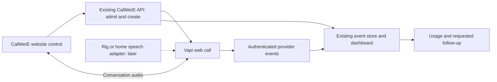

# CallMeIE website push-to-talk integration

11 October 2026. Status: mapped for implementation. The website voice feature is not built or live. This plan continues the existing website project. It does not create another tenant platform or replace Great National or Urban Ireland work.

## Outcome and recommended first version

A visitor can talk to Claire about CallMeIE, ask follow-up questions, and request a message or callback where the existing verified workflow supports it. Irish AI phone reception remains the primary offer; websites remain secondary. Information-only conversations require no name, phone number or email.

Use the existing Vapi conversation service and CallMeIE backend first. Reuse the current shared event store, authenticated provider receipts, configuration revisions, dashboard and notification contracts. Add the missing browser admission, session association and microphone adapter in their existing owners. Keep the original website design and sample player.

The rig and home server are candidates for later speech components. Current inspected work proves finite queued Breeze synthesis and saved audio playback, not a public realtime speech stack. Hetzner can continue to host the existing application and storage; it does not itself provide a working conversation engine. Local inference and cloud failover require separate qualification against the same browser workflow.

The API proxy handles admission and call creation. Media still uses the provider's transport. A proxy does not make media local or provide EU-only processing. Vapi documents this bootstrap pattern and a custom SDK API base URL. [Vapi proxy guide](https://docs.vapi.ai/security-and-privacy/proxy-server).

## Reviewed sources and current state

W = this website worktree. P = `C:/Users/a33_s/Desktop/claude MCPs/New repos/callmeie-system`. B = `P/development/backend/scripts`. L = `P/development/breeze-private-sample-20261010/scripts`.

The published website remains `d63bf9e5d66822ddb37d670eb59a7f2fc424a9d3`. The retained live shared backend source is `981daca0606d7e4f197731cf8c23824a1d292a38`, identified by the Great National checkpoint. B is shared development source, not proof of production adoption. Later archive work in `development/admin-dashboard-repair-20261008` remains local. Do not deploy that older repair worktree over the newer live source.

| Part | Reuse and exact source | Required addition or limit |
| --- | --- | --- |
| Website presentation | W/DESIGN.md; assets/js/audio-player.js; receptionist/demo.html | Preserve original logo, paper, burgundy, Fraunces and Inter. Saved MP3 playback and telephone links are already working; they are not browser conversations. |
| Website API | B/server.py:2569, POST /api/discovery | Existing service owner and public API domain. The quiz is a structured recommendation flow, not a text or voice agent. |
| Provider status and final reports | L/server.py:1331; L/billing/webhook.py:107; L/billing/status_events.py:48 | Authenticated receipt handling, committed dedupe and terminal guard. Add trusted website-session linkage and source classification. |
| Call records | B/server.py:852; L/billing/status_events.py:113 | Reuse call_events and its owning database. Browser UI events must not impersonate provider receipts. |
| Knowledge and revisions | B/property_call_configuration.py:18,57,88; property_configuration.py | Reuse server-selected configuration snapshots. Supply approved CallMeIE website information and business permissions. |
| Message persistence | B/property_intake.py:141; property_router.py:133 | Reuse operation identity, revision checks and durable acknowledgment. Add a small website enquiry adapter where the current business schema requires it. Urban resident/unit fields are not website requirements. |
| Dashboard | L/server.py:7202; B/property_dashboard.py:80; B/server.py:8448,8532 | Existing operations view and tenant-scoped transcript/duration joins. An information-only call without an intake row must still appear in the website conversation view. |
| Follow-up | B/property_notifications.py:367; property_notification_worker.py:64 | Reuse queue, committed claim and uncertain-send handling. Choose an approved channel and recipient. No automatic demo SMS or callback. Existing SMS evidence does not establish email delivery. |
| Usage | L/billing/usage.py:19; B/billing/vapi_period.py:28; property_vapi_audit.py:44 | Current audited ownership path requires inboundPhoneCall and Twilio leg. Add an explicit webCall contract. No fabricated carrier leg. Internal demo expense and customer charges must remain separate. |
| Recording and retention | P/facts/retention-and-privacy.md; Great National ACTIVE-CHECKPOINT.md | Existing archive owner and known gaps. Raw audio storage is not required for the first website feature. Transcript retention and other copies still need an effective policy. |

Urban's retained real phone reports and local dashboard repair are useful evidence for joins, notes and display. Its offline target collector is deliberately tied to finite phone fixtures; it is not a web ingestion service. Great National's synthetic browser dashboard is not a browser voice implementation. Neither project gives a public visitor access to its tenant records.

Four bounded agent reviews are retained outside Git under `C:/Users/a33_s/AppData/Local/callmeie-site-review-20261010/`: `push-to-talk-gn-reuse.md`, `push-to-talk-urban-reuse.md`, `push-to-talk-browser-reuse.md`, `push-to-talk-infra-reuse.md`. They contain the exact source locators and accepted/local boundaries. No customer records or credentials were copied.

Requested history lookup used the existing ask_system.py with explicit stores, rule synthesis and --no-learn. It recovered the owner's earlier push-to-talk request. The Codex rollout index was locked; other returned memory results were unrelated or blank. This was not a complete transcript search. Maintained project checkpoints and inspected source supply the integration evidence.

## Visitor interaction and design

First place a compact custom control beside the receptionist demonstration on Home and the Receptionist page. Use the same controller and design on both pages. Do not add an always-open overlay to every page. Keep listening to examples, calling the demo number and using the contact form available.

Suggested copy: “Talk to Claire” and “Ask about CallMeIE.” After connection: “Hold to talk.” Release closes the microphone input gate; the conversation stays connected for follow-up. Display short observed statuses: Connecting, Ready, Listening, Replying, Ended. Show optional readable captions with speaker labels. Explain that this is an AI demonstration before starting. Keep any processing/storage notice accurate to the selected settings.

One explicit activation starts permission and connection. Do not connect or request microphone access on page load. Show Ready only after media connection succeeds and the input gate is confirmed closed; do not treat the initial click as a hold that remains open through a permission prompt. Stop sample playback before conversation audio starts. End is always available. A visible toggle mode supports people who cannot hold a control.

Keep the original type hierarchy and spacing. Use custom SVG controls rather than emoji or browser-native audio chrome. Button target at least 44 px, visible focus, text status and a restrained level indicator. Status must not rely on colour. The widget must not cover headings, previews, menus, legal information or the existing fixed contact dock.

The optional 3D phone is a later enhancement inside this same section. Ground its base in the composition; lift the receiver only after actual connection, return it on end. Listening/speaking effects follow observed events. Static mobile and reduced-motion versions must work without 3D. Do not add a separate floating phone hero or new design identity. Blender follows the existing rig/GPU queue and maintenance owner when this stage is reached.

## Browser lifecycle and actual push-to-talk semantics

Use one persistent web call per conversation. Do not create a paid call on each press. Release mutes input; it is not an explicit provider turn-commit operation. Natural speech interruption depends on the selected assistant and measured provider behavior. Playback mute is not proof that generation was cancelled.

| State | Required behavior |
| --- | --- |
| Idle | No call or microphone stream. Start and fallback choices available. |
| Permission pending | User may cancel. Late permission resolution cannot start an abandoned conversation. No hold state carried into readiness. |
| Connecting | One in-flight attempt. Microphone transmission closed. Show slow/error state from actual transport behavior. |
| Ready | Connected, input closed. First deliberate hold opens input. |
| Listening | One primary pointer or focused keyboard action. A repeated keydown or second finger cannot create another call or override release. |
| Waiting or replying | Input closed after release; captions and speaking status come from actual events. Another deliberate hold may interrupt, subject to verified provider behavior. |
| Ending | Close input first; end the provider session and destroy local tracks/listeners. Ending is not proof that final processing has finished. |
| Failed or disconnected | Input closed. Explain retry/new session or text/phone fallback. Do not start another paid session automatically. |

Close the input gate on pointerup, pointercancel, lostpointercapture, blur, page hiding, Escape, End, transport error and device loss. Space/Enter operate only when the control is focused; ignore key repeats. Preserve page scrolling outside the control. Keep a status live region and captions usable at enlarged text sizes. [MDN pointer events](https://developer.mozilla.org/en-US/docs/Web/API/Pointer_events).

Register provider handlers before start. Retain call.id through the backend association when creation succeeds even if local validation or media join later fails. The inspected SDK start() returns call details after join, so its return value alone cannot cover a failed join. Distinguish call-start/end, speech-start/end, transcript messages, device errors and local desired microphone state. Do not infer readiness, save success or provider termination from animation or a timer.

SDK start has no cancellation signal in the inspected source. Each attempt needs a generation identity: cancellation invalidates that identity, closes input and initiates backend termination/reconciliation. Any late create/join completion must immediately clean up rather than revive the UI or open the microphone. stop/end alone during a pending start is insufficient. Backend association/status supplies creation evidence when the browser no longer receives the start result.

**Microphone implementation gate:** inspected upstream @vapi-ai/web main reports2.7.1, but it is not an installed accepted pin here. Its constructor type accepts startAudioOff while createCallObject omits it. Its audio-processor recovery enables local audio. Calling setMuted on call-start is therefore insufficient to promise that audio leaves only while held. [Inspected SDK source](https://github.com/VapiAI/client-sdk-web/blob/main/vapi.ts).

Before live PTT, pin a reviewed SDK revision and implement/qualify input gating before initial join and throughout recovery. Candidate approaches are a small owner-maintained SDK adapter that consistently respects desired mute state, or a controlled media source that cannot forward microphone signal while closed. Select the smallest proven option. Test transmitted audio, not only the icon or local mute getter. Fail closed and end the session when recovery cannot preserve the guarantee. This is a concrete integration gap, not a completed patch.

Microphone access requires HTTPS/localhost and browser permission. The11October public HEAD check returned200 from GitHub Pages for callmeie.ie with no observed microphone restriction in that response. api.callmeie.ie returned405 for HEAD with microphone=(), autoplay=() and its own CSP. Those API headers do not themselves restrict a top-level page hosted on another origin. Recheck the actual document, embed policy and provider connection destinations for the selected deployment. Do not loosen policies across unrelated dashboard routes. [MDN getUserMedia](https://developer.mozilla.org/en-US/docs/Web/API/MediaDevices/getUserMedia).

Assistant audio must start from an intentional user activation. Handle audio blocked separately from microphone denied; offer Enable audio if needed. Real iOS/Safari and Android tests are required. [MDN autoplay](https://developer.mozilla.org/en-US/docs/Web/Media/Guides/Autoplay).

## Backend admission, session association and records

Recommended bootstrap: a narrow web-call proxy inside the existing CallMeIE API owner. It admits one configured website assistant, creates the provider call, and stores authoritative linkage before returning media connection information. Vapi documents custom API routing; inspect and pin the actual SDK request shape during implementation. Do not implement a generic provider proxy or pass through arbitrary assistant configurations.

A short-lived restricted public JWT is a documented alternative. It can constrain origins, assistants and transient creation, but expiry alone is not a one-call budget, server-owned association or concurrency limit. Use it only if equivalent admission and authoritative linkage can be enforced. Dashboard/client tokens and billing portal sessions are not voice credentials. [Vapi JWT authentication](https://docs.vapi.ai/customization/jwt-authentication).

Proposed contracts below are additions, not existing endpoints. Confirm naming against the selected backend owner before coding. With the inspected SDK, pass the admitted opaque capability as its constructor API token and use a custom API base ending /api/website-voice; the SDK appends /call/web. Resolve creation operation identity from the admitted server record. Do not assume the unmodified SDK sends custom session/operation headers or arbitrary request fields. Qualify this exact token/base/request mapping before adoption.

| Contract | Input and server-owned result |
| --- | --- |
| POST /api/website-voice/sessions | Bounded page identifier, client attempt/operation ID and notice revision. Server chooses website scope, assistant, configuration/knowledge revisions, permitted actions and cost class. Returns opaque session capability and expiry; no provider/admin secret. |
| POST /api/website-voice/call/web | SDK-compatible narrow bootstrap under the custom API base. Requires the admitted session and same creation operation ID. Server ignores/rejects caller-supplied tenant, destinations, assistant override or billing class. Creates one call and persists its provider ID. Exact request/response shape must match the pinned SDK. |
| GET /api/website-voice/sessions/{id} | Requires that session's capability. Returns connection/final-report/request-save state only for that session. No arbitrary call lookup, staff notes or other tenant records. No capability in query strings or analytics. |
| POST /api/website-voice/sessions/{id}/end | Close request with operation identity. Distinguish acknowledged end from pending/unknown termination. Reconcile through existing provider evidence. Browser transport cleanup remains immediate. |

Use the existing database migration owner. A small session association record is justified; another transcript/event store is not. Persist session ID, creation operation ID, server-resolved website scope/assistant/configuration revision, source=website, transport=webCall, cost class, provider call ID, timestamps, last qualified state and expiry. Store only bounded UI timing/error metadata needed for acceptance and operations.

Before provider creation, commit the admitted operation. After provider acknowledgment, retain its ID and association before releasing join information. Callback arrival before response delivery must reconcile by the same exact provider ID. Handle multiple tabs explicitly. Exactly one creation is allowed per admitted operation; browser refresh or double-click must not create a second paid call.

A timeout may follow provider creation or database commit. Do not claim failure or create a replacement blindly. Keep the attempt pending/uncertain and reconcile through available provider identifiers/evidence. If the selected provider contract cannot resolve an unknown create outcome safely, report uncertainty and stop automatic retries. Do not assume provider idempotency merely because our API accepts an operation ID.

Provider status/final reports must enter the authenticated live receiver, not the unverified legacy development handler. Verify call/assistant/type against the admitted association, commit dedupe, and retain terminal semantics. Browser events can report UX observations; they cannot confirm call ownership, duration, transcript integrity, saved message, delivery or billable usage.

Apply origin checks, bounded request sizes, session expiry, per-session/per-source rate limits, global concurrency and a server/provider-enforced maximum duration. CORS is not authentication. Proposed initial limits: one active call per session, five-minute maximum, one-minute idle termination and a configurable daily spend/concurrency cap. These are initial operating settings to qualify, not existing live limits. Hard limits must survive a closed tab and local timers failing. Avoid identifying anonymous visitors through a new fingerprinting system.

## Approved answers and actions

| Visitor intent | Minimum information | Allowed result |
| --- | --- | --- |
| Ask what CallMeIE offers | The question | Brief approved answer about Irish phone reception; explain website service only when relevant. |
| Ask pricing, hours or setup | Relevant business context only when necessary | Cite the approved current plan information; distinguish options/integrations from included features. Offer the matching page. No invented coverage or quote. |
| Ask to try a business scenario | Optional business type and scenario | Clearly identified demonstration using fictional details. No real booking, emergency dispatch, outbound call or customer-system mutation. |
| Request contact/message | Message and agreed scope; only a requested reply/callback additionally requires its chosen channel and necessary destination | Confirm details, persist through the existing action owner, then acknowledge the actual result. Anonymous message-only enquiries and declined/partial contact information remain supported. |
| Ask for unavailable/private information | The question | Explain the limit and offer the appropriate public contact route. No Urban resident records, GN hotel data or private operator tools. |

Inspect the saved Claire assistant's effective prompt, tools, recording settings and current role. Reuse it if suitable without weakening existing telephone behavior. If public website knowledge/actions need a distinct saved assistant configuration, create one through the existing owner while keeping the same operational engine. No new assistant on each test.

Pin approved public knowledge from the current website and offer owner. A public page or model output cannot change operational permissions. Configuration/source revision must be fixed for each session and visible in operational records. Reuse tenant-approved Irish recognition vocabulary where relevant, with STT and TTS acceptance separate. Do not treat saved Irish voice clips as live recognition or latency evidence.

Plain text conversation is a possible later channel using the same approved knowledge and action adapter. The current quiz is not equivalent chat. First release must always retain approved contact-form, telephone and saved-playback fallbacks; qualify form delivery before claiming messages arrive. Do not show a fake working chat input while that endpoint is absent.

## Tracking, usage, follow-up and privacy

Record admission, provider creation, connection, permission/device failure, input opened/closed, first response timing, disconnect/end and qualified final receipt. Keep operational metadata separate from transcript content and optional enquiries. Analytics receives only approved aggregate UX events; no voice audio, contact information, transcript, session capability or raw provider artifact URLs.

Use session/attempt/provider call IDs as exact joins. Keep client monotonic durations separate from server/provider UTC timestamps. The existing status feed's ended marker remains absorbing; late connected events cannot reopen a terminated session. Missing duration/cost remains unknown until qualified evidence arrives.

Dashboard: an isolated CallMeIE website source/filter, existing permissions, conversation status/duration/provider expense, approved knowledge revision and requested enquiry outcome. Information-only calls should appear without compulsory lead capture. Keep connection ended, report pending, report committed, message committed, notification queued, provider accepted and delivery confirmed separate. Existing append-only staff note endpoints are not an idempotent public message API.

Classify website conversations server-side as CallMeIE internal website-demo expense. Customer billable usage is zero for this scope; provider expense still exists. A caller saying “testing” must not choose billing treatment. Extend the existing phone-only audit with an explicit authenticated webCall evidence path; preserve all phone-leg guards. Provider connected duration, AI-active time, display estimates, allowances and final billed units are different measures. Keep unknowns null rather than deriving confirmed AI/billable minutes from total duration.

Default proposal: no raw audio archiving for the public website feature. Confirm effective provider settings and all participating assistants before making that statement to visitors. Microphone permission is not recording/storage consent. Decide separately what operational metadata, transcripts, submitted messages, provider logs and backups are stored and their actual expiry. Existing 30-day audio/90-day transcript targets are not proof of enforcement. Do not inherit hotel-specific consent or the legacy archive's 90-day comments.

Reuse the existing recording/retention owner where recording is needed later. Signed playback URLs and recording-presence flags do not prove archived integrity, permission or deletion. Do not display, log, persist in browser storage or send provider media URLs/tokens to analytics; required join data can exist transiently in SDK memory. Dashboard credentials must never enter the public browser. Set accurate feature disclosure through the existing public privacy owner; do not promise EU-only processing or universal no-recording from unverified settings.

Do not automatically apply legacy demo/client SMS branches to web calls. Follow-up requires the caller-selected approved channel, verified destination and actual configured transport. Reuse queue idempotency and uncertainty handling; do not resend after an unknown send outcome. Internal staff alerts and visitor follow-up are different policies.

## Hosting and fallback qualification

| Component | Established evidence | Decision for this feature |
| --- | --- | --- |
| GitHub Pages website | Current d63bf9e release, live200 and existing visual/audio checks | Keep public frontend here. No redesign or hosting migration required. |
| Existing API/shared deployment | api.callmeie.ie response observed;981daca identified by backend owner checkpoint | Extend the current owner in an isolated worktree; reconcile later local fixes selectively. Verify actual deployment parity before activation. |
| Vapi and configured cloud speech services | Existing telephone service and official browser call contract | First candidate for actual browser acceptance. Read selected assistant/provider config; previous phone acceptance does not prove browser acceptance. |
| Rig Breeze/gpuq | Finite25.2s audio in90.518s,36.08s in117.901s including load | Saved internal synthesis only under its existing scope. No realtime/warm latency or public deployment proof. |
| Home server | No qualified public speech route established in inspected sources | Resolve current owner, endpoint, auth, licence and health before selection. Do not infer an available fallback from hardware ownership. |
| Hetzner | Existing application/database/archive owner | Hosting location for an eligible adapter, not an automatic voice replacement. Preserve current maintenance and release authority. |

Later local components need warm load/queue limits, compatible streaming formats, cancellable generation, language/name quality, licensed public use, actual tool behavior, privacy and end-to-end latency/concurrency acceptance. Cloudflare connectivity alone proves none of these. Preserve the 9 October rig no-auto-boot maintenance hold; no power/daemon change is needed for this map.

Qualify failures separately: admission unavailable, microphone denied, media join failure, STT failure, language-model failure, TTS failure, network loss and final-report/store failure. A classifier fallback inside /api/discovery is not a speech fallback. Use provider-supported fallback only after selected configuration and runtime evidence show it works.

Do not silently move an active conversation between providers or replay its audio. On uncertain disconnect close the input gate, determine existing call state and offer deliberate reconnect or a new session. Reconnect requires a retained live room and still-active call; retained rooms may continue provider usage. First release must explicitly select and qualify roomDeleteOnUserLeaveEnabled=true through the SDK start options/provider create request, rather than assume an unknown default or rely on stop alone. Avoid room retention solely for speculative reconnect. Track each genuine replacement call separately.

## Build sequence and completion evidence

| Stage | Concrete work and owner | Completion evidence |
| --- | --- | --- |
| 1. Integration selection | Existing backend owner/worktree and saved assistant; approved knowledge/actions; selected privacy settings; SDK/gate decision | Exact source/config revisions, effective tools and microphone contract. No change to unrelated telephone routing. |
| 2. Local browser control | Website controller, restrained widget, captions, sample coordination, disabled-by-default feature; injected fake transport only for local lifecycle checks | Local pointer/keyboard/permission/cancel/error/recovery tests; visual review at320,390,768,1280px and enlarged text. A mock pass is not voice acceptance. |
| 3. Backend bridge | Admission/call proxy, association record, narrow status/end readback, existing authenticated receiver integration | Real local HTTP/database tests with provider stub: duplicates, callback ordering, unknown commit/create, scope isolation and duration limits. No second event engine. |
| 4. Tracking and actions | Existing dashboard source filter, optional enquiry adapter/queue, explicit webCall usage path | One fixture produces committed correlated records, correct internal expense classification and confirmed save state. Phone guards stay intact. No automatic SMS. |
| 5. Actual browser voice acceptance | Selected authorised provider path; bounded real calls from desktop and physical mobile | Held-only transmitted audio, approved answers, actual receipts/dashboard linkage, cost/duration and all failure outcomes. Record counts/provider expense and configuration; avoid repeating old phone tests without a changed dependency. |
| 6. Publish and monitor | Website/API owners, feature flag, deployed header/origin/SDK pins and operating caps | Same end-to-end behavior on production; one bounded smoke conversation and record readback, not only successful CI. Rollback disables admission/widget without affecting the sample player or phone service. |
| 7. Optional enhancement | Approved grounded phone asset; possible local speech adapter | Separate visual and performance acceptance. Never delay a working voice feature for decorative3D. |

Stage 2 can proceed locally with an injected transport before provider activation. Stages 1 and 3 must resolve the actual source/configuration binding; local code alone cannot close these gates. This planning pass performs no provider creation, paid calls, service start or publication. No broad provider/model migration is needed.

## Focused acceptance matrix

| Area | Cases and required observation |
| --- | --- |
| Microphone | Initial permission/join, ready idle, hold/release, rapid presses, recovery, background, device loss and End. Inspect transmitted signal; no user audio while gate closed, tracks released on end. |
| Input/accessibility | Touch release outside button, pointer cancellation, second pointer, focused Space/Enter and repeats, Escape, toggle mode, keyboard-only, screen reader, zoom and reduced motion. |
| Audio/conversation | Actual Safari autoplay/unlock, speaker/headset, sample stops, short utterance, speech interruption, noisy Irish business names and corrected contact details. No false “saved” or unwanted end on refusal. |
| Connection | Permission pending/denied, no device, bootstrap timeout before/after creation, lost response, join failure, network drop, refresh/multiple tabs, explicit retry. No silent second call or live mic after error. |
| Persistence | Callback before bootstrap response, duplicate status/final reports, late nonterminal event, report delayed/missing, save timeout after commit and stale revision. Exact admitted IDs; one durable result and no blind duplicate notification. |
| Isolation and policy | Cross-session reads, other assistant/tenant callback, caller-supplied destination/assistant/cost override, expired session and caps. No customer records or privileged tokens reach public browser. |
| Usage | Web call without carrier leg, pending/unknown cost, internal-demo expense, definite end versus local disconnect, final receipt. Preserve phone audit behavior and independent provider expense. |
| Layout | Actual normal screenshots on Home/Receptionist at four widths; open menus, captions, long text/status, fixed dock, enlarged text. Check local overlaps as well as horizontal overflow. |
| Fallback | Voice unavailable leaves working samples/contact/phone. Form delivery tested separately. Rig/home/provider failover acceptance stays open until actually exercised. |

Suggested performance targets, not measurements: microphone gate closes within 50 ms of release in foreground; no pre-hold audio leakage; first response after release median <=1.5 s and p95 <=3 s on the accepted network/device set; connection-ready median <=3 s excluding time spent at permission. Compare short/long turns and noisy samples, separate STT/turn detection/model/TTS/network delays, and report sample count. Percentile acceptance requires enough independent observations to support it; one smoke conversation cannot establish p50/p95. Keep paid failure tests bounded and selected for changed dependencies and actual risk. A slow response should show an honest status without continuous narration. Provider timestamp availability and device scheduling limits must be recorded.

## Next executable slice

Start with the local website controller and the smallest backend admission/association adapter in the current live-source family. Qualify the input gate before any held-only privacy claim. Then run one browser conversation through the existing authenticated report store and dashboard, classified as CallMeIE website-demo expense. This closes the missing end-to-end path before adding 3D or a self-hosted speech route.
